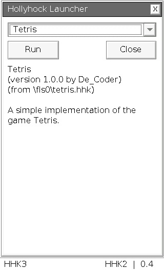

# Hollyhock 3 Custom Launcher

Custom Launcher fuer den Casio ClassPad II: **HHK2-Ansicht und Bedienung auf HHK3**, mit `.hh3`- und experimenteller `.hhk`-Unterstuetzung.

Aktueller Stand: **0.4**, fuer bereits installiertes HHK3 auf **OS 02.01.7002.0001**.

## Download und Installation

- [Komplettes Paket 0.4](downloads/v0.4/hhk-dual-launcher-0.4-classic-exit-fix-os7002.zip)
- [run.bin](downloads/v0.4/run.bin)
- [Deutsche Anleitung](docs/README_DE.md)
- [Pruefbericht und Grenzen](docs/TEST-REPORT.txt)

Die vorhandene `run.bin` sichern und die neue Datei ins Hauptverzeichnis des Taschenrechner-Laufwerks kopieren. Sicher auswerfen, USB trennen und den Launcher wie bisher oeffnen. **Kein Firmwareupdate erforderlich.**

## Funktionen

- HHK2-Layout mit Dropdown, Run, Close und Programminformationen.
- Direkte Touch-Ereignisverarbeitung und physische Pfeil-, EXE- und Clear-Tasten.
- HH3-ELF-Lader und konservative HHK2-SDK-Adressuebersetzung.
- Korrektur des Beendens in 0.4: gueltiger Rueckgabeadapter fuer den geprueften OS-7002-Aufrufer, ohne Abschlussfenster. Bei anderer Aufrufstelle bleibt der native Abschlussdialog erhalten.



## Pruefstand

50 automatisierte Pruefungen bestehen: 25 fuer UI/Eingaben, 17 fuer den HHK2-Parser und 8 fuer den OS-Rueckgabeweg einschliesslich einer eng begrenzten SuperH-Instruktionssimulation. **Version 0.4 ist noch nicht am echten Taschenrechner getestet.** Die HHK2-Kompatibilitaet ist experimentell und keine vollstaendige Emulation des alten OS.

## Entwicklung

Quellcode liegt direkt unter `src/`. Die SDK-Quellen sind unter `sdk/` und `hhk2-sdk/` enthalten. Der Build verwendet die mitgelieferte Bitmap-Schrift; uGFX wird nicht benoetigt.

Hosttests mit Python 3 und g++ mit C++23:

```sh
python3 tests/test_classic.py
python3 tests/test_legacy.py
python3 tests/test_exit.py
```

Calculator-Build: `sh4a_nofpueb-elf-g++` 15.2.0 im PATH, `SDK_DIR` auf das gebaute HHK3-SDK setzen, dann:

```sh
sh build.sh
```

Ergebnis: `dist/run.7002.bin`. Zum Verwenden in `run.bin` umbenennen. Das Toolchain-Image und die genauen Quellrevisionen stehen in [BUILD.json](downloads/v0.4/BUILD.json).

Optionale Pruefung des kompilierten Rueckgabeadapters:

```sh
python3 tests/test_exit.py --target-elf dist/run.7002.elf --target-bin dist/run.7002.bin
```

## Grundlagen und Lizenz

Basierend auf [ClasspadDev/yal](https://github.com/ClasspadDev/yal), dem [HHK3-SDK](https://github.com/ClasspadDev/hollyhock-3) und dem [HHK2-SDK](https://github.com/SnailMath/hollyhock-2). Urspruengliche Hinweise und Quellrevisionen bleiben erhalten.

Code: [GPL-3.0](LICENSE). Fuer DejaVu Sans gilt die beiliegende [Schriftlizenz](src/classic/FONT-LICENSE.txt). Dieses Repository enthaelt keine Casio-Firmware und keinen Firmware-Updater.
